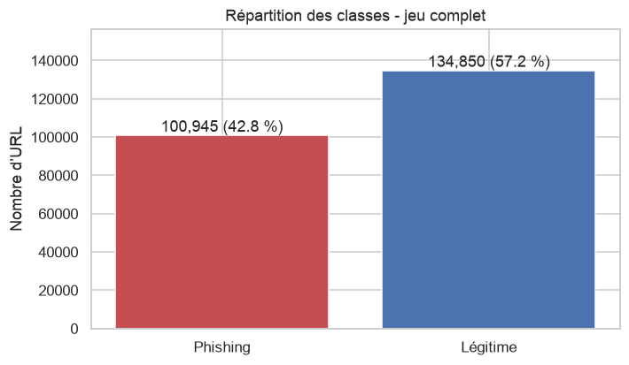
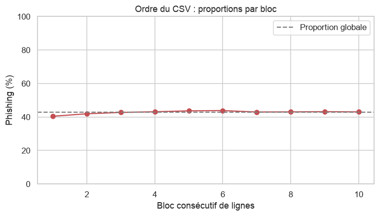
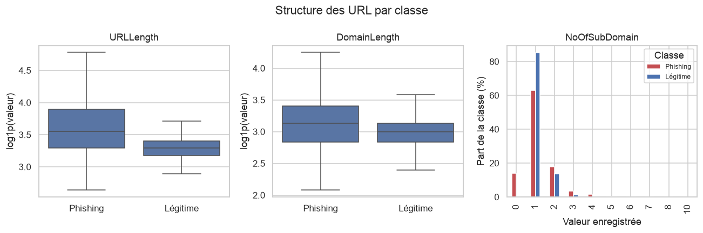
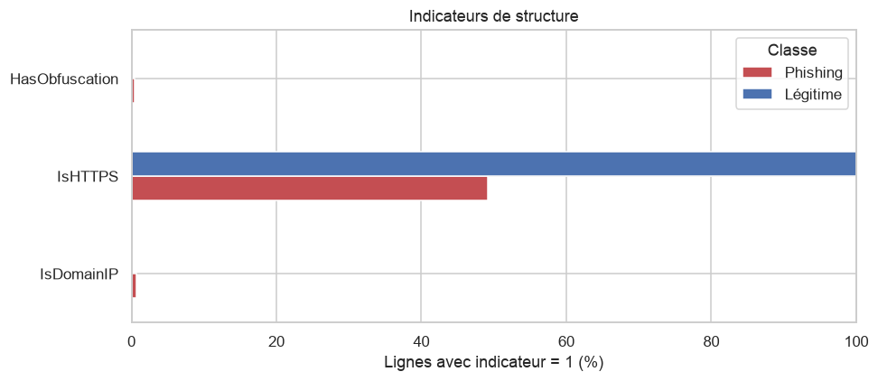
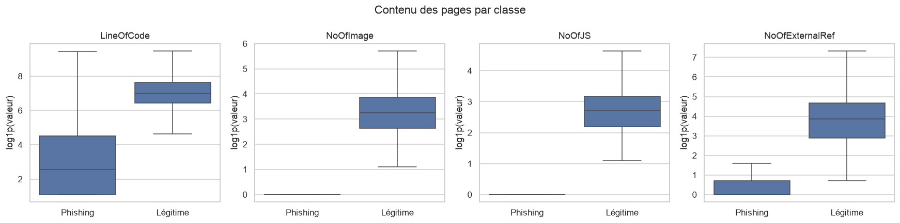
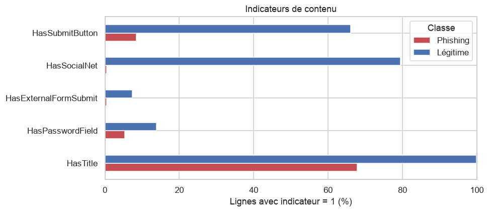
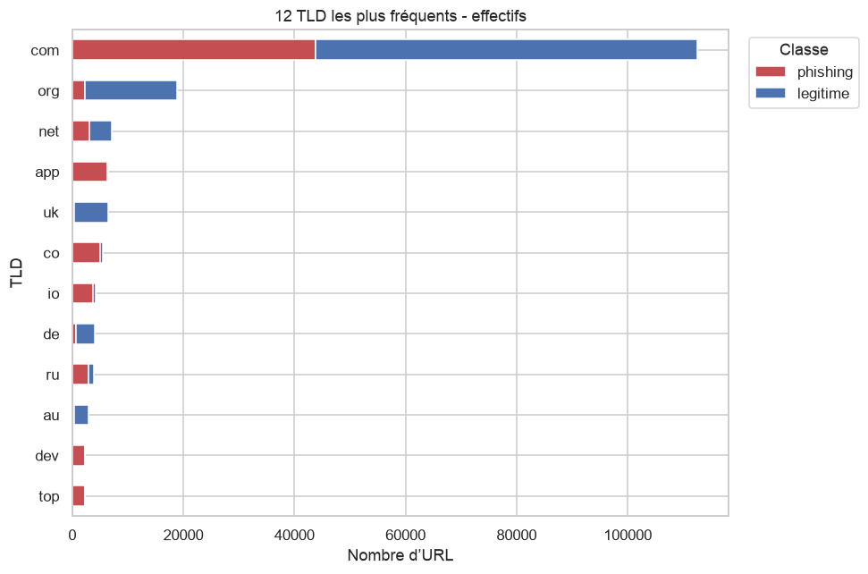
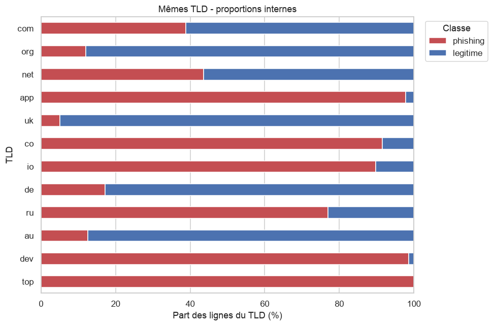
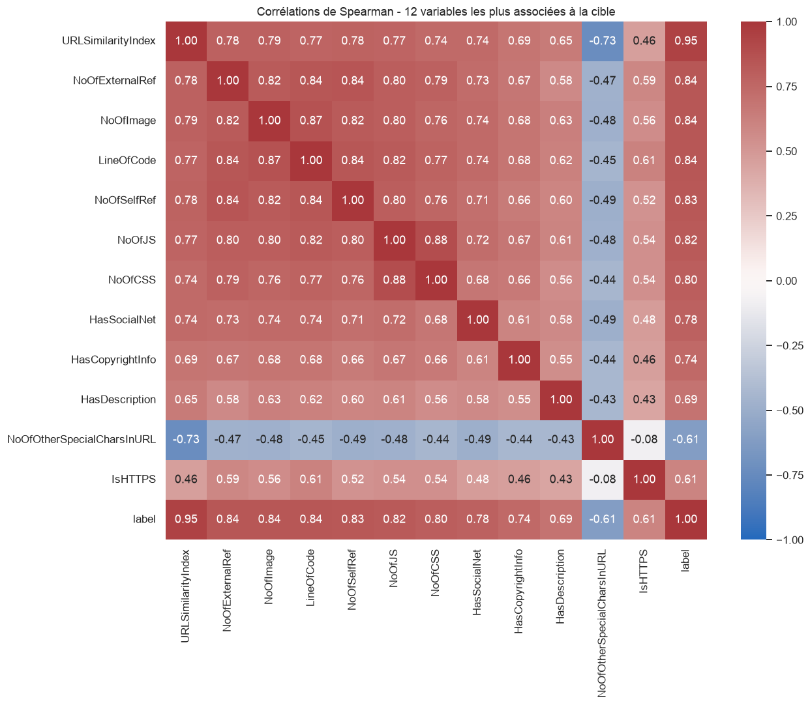
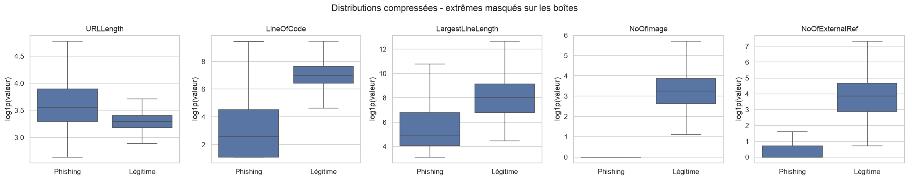

# Rapport d’analyse exploratoire — PhiUSIIL

Responsable : étudiant 2. Analyse du CSV local, 235 795 lignes et 56 colonnes. Document préparé pour relecture le 28 octobre 2026.

Le notebook associé contient le code, les sorties et les explications. Les annotations *Correction à relire* signalent les nuances apportées à la première version.

Source : [Prasad et Chandra, UCI, 2024](https://archive.ics.uci.edu/dataset/967/phiusiil+phishing+url+dataset), consultée le 28 octobre 2026. Cible : 0 = phishing, 1 = légitime.

## 1. Structure du jeu de données
**Objectif** : savoir exactement ce qu'on a.

**Questions auxquelles répondre**
- Combien de lignes et de colonnes ?
- Quels types de variables (numériques, binaires, texte) ?
- Quelle est la taille mémoire ?
- Quelle est la variable cible et que signifie chaque valeur ?
- Quelles colonnes sont des identifiants ou du texte ?

### Colonnes `NoOfURLRedirect` et `NoOfSelfRedirect`
Elles sont classées binaires alors que leur nom évoque un comptage : on vérifie leurs valeurs, et qu'aucune colonne binaire n'est constante.

### Interprétation de la section 1 :

**Faits**
- Le jeu contient **235 795 lignes et 56 colonnes** (54 variables, plus `label` et `FILENAME`), soit environ 166 Mo en mémoire. Les effectifs sont conformes à la documentation UCI : **134 850 URL légitimes** (`label = 1`) et **100 945 URL de phishing** (`label = 0`).
- Cinq familles de colonnes : 1 identifiant (`FILENAME`, à ignorer selon la documentation), 4 colonnes de texte (`URL`, `Domain`, `TLD`, `Title`), 19 binaires, 31 numériques non binaires (comptages, ratios, scores) et la cible.
- `NoOfURLRedirect` et `NoOfSelfRedirect` sont décrites comme des nombres de redirections, mais elles ne prennent que les valeurs 0 et 1 (respectivement 13,3 % et 4,0 % de lignes à 1). On les traite comme des **indicateurs** (redirection présente ou non).
- Aucune colonne binaire n'est constante.

**Hypothèse / limite**
- La raison pour laquelle ces deux colonnes sont plafonnées à 1 n'est pas établie (plafonnement ou détection de simple présence). À vérifier dans l'article de référence (Prasad et Chandra, 2024), sinon à noter comme limite.

**Point d'attention** : la classe d'intérêt pour la détection est le phishing, codé **0**. Les métriques devront préciser la classe positive.

## 2. Valeurs manquantes, valeurs cachées, doublons et cohérence
**Objectif** : repérer les problèmes de qualité **sans les corriger** (la correction relève de l'étudiant 3).

- 2.1 Valeurs manquantes classiques et chaînes vides
- 2.2 Valeurs cachées : `Title`, zéros de contenu
- 2.3 Doublons (lignes, URL, domaines)
- 2.4 Cohérence entre `URLLength` et le texte de l'URL
- 2.5 Forme des URL : page d'accueil ou chemin
- 2.6 Synthèse de la section 2

### 2.1 Valeurs manquantes classiques et chaînes vides

### 2.2 Valeurs cachées
Comme `isna()` ne détecte rien : on cherche des valeurs qui jouent le rôle de « absent » (cohérence `HasTitle` / `Title`, zéros de contenu).

### Interprétation de la sections 2.1 et 2.2 :

**Faits**
- Aucune valeur manquante, aucune chaîne vide (`URL`, `Domain`, `TLD`, `Title`), conformément à la documentation UCI.
- **Valeur cachée** : 32 714 lignes ont `HasTitle = 0` alors que `Title` est rempli. Dans tous les cas, le contenu est la chaîne `"0"` : c'est un **marqueur d'absence déguisé**, invisible pour `isna()`. L'inverse (`HasTitle = 1` avec un titre vide) n'existe pas.
- Ces lignes sont à 99,5 % des phishing : environ 32 % des URL de phishing n'ont pas de titre, contre 0,1 % des URL légitimes.
- `LineOfCode` et `LargestLineLength` ne valent jamais 0. En revanche, `NoOfImage`, `NoOfJS` et `NoOfCSS` valent 0 pour environ 34 à 36 % des lignes, avec un contraste très net entre classes :

| Part de lignes à 0 | Phishing | Légitime |
|---|---|---|
| `NoOfImage` | 83,4 % | 1,0 % |
| `NoOfJS` | 77,1 % | 1,1 % |
| `NoOfCSS` | 80,3 % | 2,0 % |

**Hypothèses (non vérifiées)**
- La cause de ces pages « sans ressource » peut être une page réellement minimaliste, une page déjà retirée au moment de la collecte, ou un téléchargement incomplet. Les données ne permettent pas de trancher.

**Conséquence pour la fiabilité** : ces variables de contenu séparent presque les deux classes à elles seules. Un modèle qui apprend « page sans image, JS ni CSS = phishing » obtiendrait de bons scores sur ce jeu mais serait fragile face à un phishing soigné ou à une page non téléchargée. À examiner en section 7.

*Correction à relire : les différences de proportions montrent une association avec la classe, mais ne suffisent pas à mesurer les performances d’une règle ou d’un modèle. « Séparent presque les classes » doit être compris comme une piste à évaluer, pas comme un résultat de classification.*

### 2.3 Doublons (constat uniquement)
- Lignes entièrement identiques ?
- URL répétées ? Domaines répétés ?
- Même URL avec des **labels contradictoires** ?
- Risque de fuite de données si ces doublons se retrouvent à la fois en train et en test (à signaler à l'étudiant 4).

*Correction à relire : numérotation harmonisée avec le plan.*

### Interprétation de la section 2.3 :

**Faits**
- **Aucune ligne identique** (hors `FILENAME`), mais **425 URL apparaissent deux fois** (850 lignes). Elles sont toutes de classe phishing, sans label contradictoire.
- Ces doublons ne sont pas des copies exactes : `URLLength` diffère dans les 425 paires et `LetterRatioInURL` dans 424, alors que le contenu de la page est presque identique (`LineOfCode` ne diffère que dans 37 paires). Un `drop_duplicates()` classique ne les détecterait pas.
- **15 709 doublons de `Domain`**, répartis sur **5 526 domaines répétés** : 5 472 sont 100 % phishing (21 123 lignes), 54 sont mixtes, **aucun n'est 100 % légitime**. Chaque domaine légitime n'apparaît donc qu'une fois, sauf cas mixtes.
- Les domaines les plus fréquents sont des plateformes d'hébergement ou de partage, tous de classe phishing : `ipfs.io` (1 197 lignes), `docs.google.com` (526), `cloudflare-ipfs.com` (359), `s3.amazonaws.com` (182)… Les dix premiers représentent 3 889 lignes.
- Les 54 domaines mixtes sont petits (2 à 4 lignes). Dans les deux exemples examinés, ce sont des **URL différentes d'un même site** : pour `linkedin.com`, la racine est légitime et `/slink?code=…` est étiquetée phishing ; pour `mod.gov.in`, la version `https` est légitime et la version `http` est étiquetée phishing.

**Hypothèses (non vérifiées)**
- Les paires dupliquées seraient la même page traitée deux fois avec une convention de calcul légèrement différente (voir 2.4).
- Les domaines mixtes peuvent être du bruit d'étiquette ou des cas particuliers réels : une revue manuelle de ces 54 cas est faisable.

**Conséquence** : un découpage purement aléatoire pourrait placer des centaines de lignes d'un même domaine à la fois en entraînement et en test, et les deux copies d'une même URL de part et d'autre du découpage. Cela ne concerne presque que la classe phishing.

### 2.4 Cohérence entre `URLLength` et le texte de l'URL
On compare `URLLength` à la longueur réelle du texte de la colonne `URL`. Écart = `len(URL) − URLLength`.

### Interprétation de la section 2.4 : 

**Faits**
- `URLLength` est différent de la longueur du texte de `URL` pour **187 151 lignes (79,4 %)**. L'écart vaut 1 dans presque tous les cas (187 149 lignes) ; deux lignes seulement présentent un écart de 4 et de 35.
- **L'écart dépend de la classe** : il vaut 1 pour 100 % des URL légitimes, mais pour 51,8 % seulement des phishing. Les 48 644 lignes à écart 0 sont **toutes des phishing**.
- Il n'y a pas d'espaces invisibles aux extrémités des URL.
- Les deux écarts atypiques sont des URL dont le texte est mal décodé (suites de type `ã`, `â€`), toutes deux phishing. Cela ne concerne que 2 lignes.

**Hypothèses (non vérifiées)**
- Pour une partie des lignes, les variables de l'URL semblent calculées sans le dernier caractère (dans les paires dupliquées, la ligne la plus courte perd par exemple le `l` final de `.html`).
- Les deux classes n'ont peut-être pas été traitées avec la même convention. La cause dans la chaîne de collecte ne peut pas être déduite des données.

**Conséquence** : `URLLength` n'est pas « fausse », mais elle n'est pas égale à `len(URL)`. Recalculer ces variables à partir du texte d'une URL saisie dans l'application web (période 3) suppose de connaître la convention utilisée à l'entraînement.

### 2.5 Forme des URL : page d'accueil ou chemin
Une URL est dite **réduite à son domaine** si, une fois retirés le schéma (`http://`, `https://`) et le `/` final, elle est égale à la colonne `Domain` (donc sans chemin ni paramètres).

### Interprétation de la section 2.5 :

**Faits**
- **Les 134 850 URL légitimes sont toutes réduites à leur domaine** (aucun chemin, aucun paramètre).
- Chez les phishing, 72 256 URL (71,6 %) sont réduites à leur domaine et **28 689 (28,4 %) comportent un chemin ou des paramètres**.
- Dans ce jeu, **toute URL avec chemin est donc un phishing** (28 689 sur 28 689). La paire `linkedin.com` vue en 2.3 suit ce schéma.

**Conséquence pour la fiabilité**
- Le jeu ne contient **aucune URL légitime avec chemin**, alors que c'est le cas le plus courant en usage réel. Un modèle peut apprendre « URL longue ou complexe = phishing » : ses scores sur ce jeu ne mesurent pas sa capacité à reconnaître une page légitime profonde, et les faux positifs sur ce type d'URL sont un risque non mesuré.
- Piste de test pour la période 2 : ajouter un chemin ou un paramètre à une URL légitime et observer si la prédiction bascule (idée à tester, pas un résultat).

*Correction à relire : le test effectué ici mesure une égalité textuelle après retrait du schéma et des barres finales. Une inégalité peut aussi venir d’un port ou d’une différence de représentation. La section 8 vérifie séparément la présence d’un chemin, de paramètres ou d’un fragment avec un parseur.*

### 2.6 Synthèse de la section 2

**Hypothèse de travail** : plusieurs indicateurs diffèrent fortement entre les deux classes, ce qui suggère que les URL légitimes et de phishing n'ont peut-être pas été collectées ni traitées par la même chaîne. Ce n'est **pas vérifié**, mais si c'est le cas, un modèle risque d'apprendre la **provenance** d'une URL plutôt que le phishing : d'excellents scores sur ce jeu, une fiabilité douteuse sur d'autres URL.

| Indicateur | Phishing | Légitime |
|---|---|---|
| Écart de longueur nul (`len(URL) = URLLength`) | 48,2 % | 0 % |
| `HasTitle = 0` (`Title = "0"`) | ≈ 32 % | 0,1 % |
| `NoOfImage = 0` | 83,4 % | 1,0 % |
| `NoOfJS = 0` | 77,1 % | 1,1 % |
| `NoOfCSS = 0` | 80,3 % | 2,0 % |
| Domaine répété (hors mixtes) | 5 472 domaines | 0 |
| URL réduite à son domaine | 71,6 % | 100 % |

**Ce qu'on peut affirmer** : ces écarts sont mesurés sur tout le jeu. **Ce qu'on ne peut pas affirmer** : leur cause. Les résultats de la section 2 sont à transmettre aux étudiants 3 et 4 (voir `resume_transmissions.md`).

## 3. Statistiques descriptives
On décrit les valeurs sans modifier `df`. La moyenne est sensible aux extrêmes ; la médiane décrit le centre et le 99e percentile indique la valeur en dessous de laquelle se trouvent environ 99 % des observations. L’asymétrie (`skew`) décrit la forme de la distribution, pas la qualité des données.

`continuous_cols` contient ici des **numériques non binaires**, y compris des comptages entiers, et pas uniquement des variables continues.

### Interprétation
- `URLLength` a une médiane de 27, une moyenne de 34,573 et un maximum de 6 097 : quelques grandes valeurs tirent la moyenne vers le haut. `NoOfCSS` a une médiane de 2, un percentile 99 de 51 et un maximum de 35 820. Ces extrêmes demandent un examen ; ils ne sont pas automatiquement des erreurs.
- Aucune variable numérique n’est constante. Une modalité représente toutefois plus de 99 % des lignes pour plusieurs variables : un signal rare peut rester utile pour une sous-population ; on ne le supprime pas sur ce seul critère.
- Les 695 TLD comprennent 408 modalités présentes moins de 10 fois. Les conclusions sur ces petits groupes seront fragiles.
- *Correction à relire concernant la section 2 : 32 719 titres valent `"0"`, dont 32 714 avec `HasTitle = 0` et cinq avec `HasTitle = 1`. L’hypothèse d’un marqueur d’absence concerne les premiers ; les cinq autres cas ne permettent pas d’affirmer une absence.*

## 4. Répartition des classes et ordre du fichier
Les proportions quantifient le déséquilibre. Les noms explicites évitent d’inverser la cible : **0 = phishing, 1 = légitime**, selon la documentation UCI. Un bloc de lignes consécutives ne représente pas une période chronologique.

### Interprétation
Le jeu contient 100 945 URL de phishing (42,8 %) et 134 850 légitimes (57,2 %). Le déséquilibre est modéré. Prédire systématiquement « légitime » donnerait 57,2 % d’accuracy, mais ne détecterait aucun phishing : l’accuracy seule ne suffit donc pas.

Les changements de classe et les proportions par bloc permettent de vérifier que le fichier n’est pas simplement séparé en deux classes. Ils ne démontrent ni un mélange aléatoire ni une indépendance des observations. Le découpage reste à la charge de l’étudiant 4, en tenant compte des URL et domaines répétés.

On compte 115 186 changements de classe entre lignes voisines. La proportion de phishing par bloc varie de 40,47 % à 43,84 % : le premier bloc diffère légèrement des suivants, sans séparation complète des classes.

## 5. Comparaisons entre classes
On utilise toutes les lignes. Les boîtes présentent la médiane, les quartiles et les moustaches usuelles (1,5 fois l’écart interquartile). Les points extrêmes sont masqués **sur ces figures seulement** pour garder la lecture possible ; aucune ligne n’est supprimée. `log1p(x)` signifie `log(1 + x)` : cette représentation conserve les zéros et comprime les grandes valeurs.

### Interprétation
Les tableaux donnent les valeurs exactes derrière les graphiques. Une différence entre classes est une association descriptive, pas une preuve qu’une caractéristique provoque le phishing.

La longueur et la complexité des URL doivent être interprétées avec le biais identifié en section 2 : les URL légitimes observées sont réduites à leur domaine par notre test textuel. HTTPS et les formulaires sont à comparer dans les deux classes : ni la présence de HTTPS, ni celle d’un champ de mot de passe ne prouve la légitimité ou le phishing.

Les ressources de page montrent des contrastes importants, cohérents avec les proportions de zéros de la section 2. Ces variables supposent de disposer du contenu de la page : elles ne sont pas directement disponibles à partir du seul texte d’une URL. Leur intérêt pour l’application dépendra du fonctionnement retenu en période 3.

**Résultats observés :** la longueur médiane est de 34 pour le phishing, contre 26 pour les légitimes. Le nombre de sous-domaines enregistré a une médiane de 1 dans les deux classes et des moyennes proches (1,169 contre 1,162) : il n’offre pas ici un contraste comparable à la longueur.

HTTPS est présent pour 100 % des légitimes, mais aussi 49,22 % des phishing. Une adresse IP et l’obfuscation ne concernent respectivement que 0,63 % et 0,48 % des phishing : leur absence ne suffit pas à rassurer.

Les médianes de `LineOfCode` sont de 12 contre 1 105 ; celles de `NoOfImage`, de 0 contre 25. Un champ de mot de passe est même plus fréquent chez les légitimes (13,85 %) que chez les phishing (5,39 %) dans ce fichier : un indicateur intuitivement suspect doit être vérifié dans les données. Cela ne signifie pas qu’un champ de mot de passe protège du phishing.

## 6. Analyse des TLD
On distingue la fréquence d’un TLD et la proportion de phishing **parmi ses lignes**. Un TLD fréquent dans la classe phishing n’a pas nécessairement une forte proportion de phishing. La colonne `TLD` est utilisée telle quelle ; elle ne décrit pas nécessairement un suffixe public complet comme `co.uk`.

### Interprétation
`com` domine les effectifs (112 554 lignes). La figure en proportions répond à une autre question que celle en effectifs : quelle part des observations d’un TLD est étiquetée phishing ?

Une proportion de 100 % dans le CSV n’est pas une certitude pour une future URL. Les TLD rares, la collecte et les domaines répétés peuvent amplifier ces associations. Le seuil de 100 observations utilisé pour le tableau est un choix de présentation, pas une garantie statistique. Les fréquences observées ici ne sont pas des probabilités de risque dans la population réelle.

Dans le CSV, la part de phishing est de 38,89 % pour `com`, 12,07 % pour `org`, 97,85 % pour `app` et 99,91 % pour `top`. Au total, 361 TLD ne sont observés que dans une classe, et 102 TLD comptent au moins 100 lignes. Ces résultats restent conditionnés à cet échantillon.

## 7. Corrélations, redondances et signaux à auditer
Spearman mesure une association monotone fondée sur les rangs, adaptée ici aux distributions asymétriques. Avec `label = 1` pour légitime, une corrélation positive correspond à des valeurs plus élevées chez les légitimes. Une corrélation ne mesure ni un effet causal ni une importance de modèle.

### Interprétation et limites
Les fortes associations doivent être auditées avant l’entraînement. Des variables redondantes peuvent décrire le même phénomène ; une association très élevée avec la cible n’établit pas, à elle seule, une fuite de données.

La documentation UCI indique que `CharContinuationRate`, `URLTitleMatchScore`, `URLCharProb` et `TLDLegitimateProb` sont dérivées de caractéristiques existantes. Elle ne suffit pas à déterminer ici sur quel corpus leurs références ont été estimées, ni à reproduire tous les calculs. Il faut consulter la méthode des auteurs avant de garantir leur disponibilité sur une URL nouvelle. Même réserve pour la référence utilisée par `URLSimilarityIndex`.

À transmettre à l’étudiant 4 : examiner l’origine et la disponibilité de ces variables, puis comparer en période 2 des modèles avec et sans caractéristiques suspectes ou issues du contenu. Si une transformation apprend des statistiques sur les données, elle devra être ajustée uniquement sur l’entraînement.

**Limite de notre démarche :** l’EDA utilise le jeu complet. Un test issu de ce même fichier ne sera donc pas entièrement vierge d’exploration. Éviter de choisir des règles, variables et seuils sur ses résultats ; prévoir si possible un jeu externe réservé pour l’évaluation finale.

Source : [fiche officielle UCI, consultée le 28 octobre 2026](https://archive.ics.uci.edu/dataset/967/phiusiil+phishing+url+dataset).

**Résultats :** la corrélation de Spearman avec la cible atteint 0,945 pour `URLSimilarityIndex`, environ 0,843 pour `NoOfExternalRef` et `NoOfImage`, contre −0,399 pour `URLLength`. Toutes les URL légitimes ont un score de similarité de 100 ; 786 URL de phishing ont également ce score (0,78 % de cette classe). Un score de 100 ne garantit donc pas la légitimité. `NoOfDegitsInURL` et `DegitRatioInURL` sont très redondantes dans ce fichier (Spearman ≈ 0,997). Les coefficients affichés à 1,000 sont arrondis ; cela n’implique pas nécessairement une identité exacte.

## 8. Anomalies, valeurs extrêmes et vérifications complémentaires
Un extrême statistique n’est pas automatiquement une donnée invalide. On conserve les observations et on documente les questions pour l’étudiant 3. Aucun site du CSV n’est visité.

### Interprétation
Les maxima dépassent nettement les quantiles élevés pour plusieurs comptages ; l’échelle logarithmique permet de comparer le centre des distributions malgré ces écarts. Les tableaux de maxima gardent les extrêmes visibles. Une minification du HTML, une page volumineuse ou un problème d’extraction sont des explications possibles, non des causes établies.

Les contrôles de bornes détectent des incohérences simples ; même s’ils ne signalent rien, ils ne valident pas la méthode d’extraction. Les scores doivent être confrontés aux définitions des auteurs.

*Vérification à relire de la section 2.5 : le tableau issu de `urlsplit` distingue effectivement chemin, paramètres et fragment, et compte les échecs de parsing. Il est plus précis que la seule égalité textuelle avec `Domain`. Ces résultats décrivent ce fichier, pas la sûreté d’un chemin ou d’un domaine sur Internet.*

**Résultats des contrôles :** aucune valeur numérique non finie, négative, aucun ratio hors des bornes attendues, aucun score hors [0,100] et aucun `DomainLength > URLLength` n’ont été détectés.

Les extrêmes ne sont pas tous dans la même classe : le maximum de longueur d’URL (6 097) est phishing, celui du nombre de lignes de code (442 666) est légitime. Pour `LargestLineLength`, la moyenne est plus élevée chez les phishing (20 021 contre 7 376), alors que leur médiane est plus faible (138 contre 3 066) : quelques extrêmes inversent la comparaison des moyennes.

*Correction à relire de la section 2.5 : `urlsplit` trouve 27 456 phishing avec un chemin non racine, 6 079 avec des paramètres et 28 489 avec l’un ou l’autre (28,22 %). Les catégories se recouvrent. Le premier test trouvait 28 689 inégalités textuelles : les 200 cas d’écart ne doivent pas être présentés comme des chemins ou paramètres confirmés. Il n’y a aucune erreur de parsing. Chez les légitimes, les trois indicateurs chemin non racine, paramètres et fragment sont tous nuls.*

## 9. Synthèse générale et transmissions

| Sujet | Constat / action proposée | Destinataire |
|---|---|---|
| Cible | 0 = phishing ; 1 = légitime. Préciser la classe positive des métriques | Étudiants 1 et 4 |
| Équilibre | 42,8 % phishing ; 57,2 % légitimes. Accuracy majoritaire : 57,2 % | Étudiant 4 |
| Titres | 32 714 absences indiquées par HasTitle avec Title="0" ; cinq autres titres "0" à examiner | Étudiant 3 |
| Doublons | 425 URL distinctes répétées, 850 lignes concernées, caractéristiques différentes | Étudiants 3 et 4 |
| Domaines | 5 526 domaines répétés dont 54 mixtes ; tenir compte des hôtes et si pertinent des domaines enregistrables | Étudiant 4 |
| Longueurs | Écart entre longueur du texte et URLLength dépendant de la classe | Étudiants 1 et 3 |
| Forme des URL | Faible diversité des formes légitimes ; vérifier la généralisation aux pages profondes | Étudiants 4, périodes 2 et 3 |
| Distributions | Fortes asymétries et modalités très majoritaires ; ne pas supprimer automatiquement les extrêmes ou signaux rares | Étudiant 3 |
| TLD | 695 modalités, dont 408 présentes moins de 10 fois ; prudence sur les proportions des petits groupes | Étudiants 3 et 4 |
| Variables dérivées | Auditer références de calcul, disponibilité et risque de fuite avant la modélisation | Étudiants 1 et 4 |
| Contenu | Nécessite le HTML ; fortes différences de présence de ressources entre classes | Périodes 2 et 3 |

### Ce que cette analyse permet de conclure
Le fichier présente des associations exploitables mais aussi des particularités susceptibles de faciliter artificiellement la classification. Les observations justifient une évaluation attentive aux doublons, aux groupes de domaines et à la disponibilité réelle des variables. Elles ne démontrent pas les performances d’un futur modèle.

### Limites et suite du projet
L’analyse est descriptive et réalisée sur tout le CSV. Aucun modèle n’est entraîné, aucune donnée n’est nettoyée, aucun split n’est créé. La collecte, les dates individuelles et les définitions détaillées de certaines variables restent insuffisamment documentées dans cette analyse. Les périodes 2 et 3 devront examiner faux positifs, faux négatifs, calibration, incertitude, robustesse aux variations d’URL et généralisation externe.

### Relecture avant rendu
Les mentions *Correction à relire* identifient les nuances ajoutées au travail précédent. Relire les sorties, les figures et les interprétations ; reformuler avec ses propres mots. Pour reproduire : ouvrir ce notebook depuis `periode-1/notebooks/`, redémarrer le noyau puis exécuter toutes les cellules. Les figures sont enregistrées dans `../reports/figures/`.

